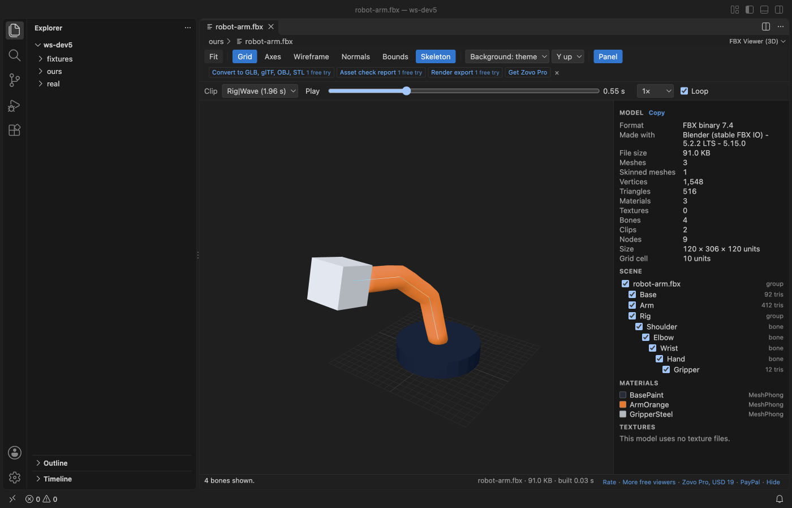

# FBX Viewer & DAE, 3DS Preview

Open FBX, Collada (.dae) and 3D Studio (.3ds) models in VS Code as a 3D view, play their animation clips and see their bones, materials and missing textures. Made by Zovo.

Free, with no account and no network calls:

- Opens .fbx files (binary and ASCII, FBX 7.0 and later), Collada .dae and 3D Studio .3ds files in a 3D view.
- Orbit, pan, zoom and Fit. Toggles for the grid, axes, wireframe, vertex normals, bounding box and skeleton. Theme, dark or light background, Y or Z up.
- Plays the animation clips stored in the file: clip list, play and pause, a timeline you can drag, speed from 0.25× to 2× and looping on or off.
- A panel with the model facts (format and version, the program that wrote the file, meshes, vertices, triangles, materials, textures, bones, clips and the size in model units), the scene tree with meshes, groups and bones, the materials with their texture slots, and the textures with their size.
- Textures load from the folder next to the model and from its direct subfolders (such as textures/), also when the file stores a full path from another computer. Missing texture files are listed by name. TGA textures work too.
- An FBX file older than version 7.0 gets a clear note with its version and how to export it again, never a blank view.

Zovo Pro: USD 19 once, for the Pro tools in every Zovo extension. Each Pro tool has 1 free try on your computer first:

- Convert to GLB, glTF, OBJ or STL: GLB and glTF keep the materials, textures and animation clips; OBJ comes with a .mtl material file; STL holds the triangles for 3D printing.
- Asset check report for game and AR pipelines: triangle budget, texture sizes and missing files, textures that are not a power of two, non-uniform or mirrored scale, flipped normals, unused material slots and bones per mesh. Save it as Markdown or CSV.
- Render export: a PNG of the view at the size you pick, up to 8192 pixels, with a transparent background if you like, or a strip of animation frames in one PNG.

## How to use it

- Click an .fbx, .dae or .3ds file in the Explorer. It opens in the viewer. Drag to orbit, right-drag or Shift-drag to pan, scroll to zoom.
- Keys in the view: F fit, G grid, A axes, W wireframe, N normals, B bounds, K skeleton, P panel, Space play or pause.
- To try it without your own files, run FBX Viewer: Open the Sample Robot Arm (FBX) from the Command Palette.
- The Pro tools are in the Command Palette (FBX Viewer: ... (Pro)), in the editor title menu (...) of the viewer, in the Explorer right-click menu of a model file, and in the small row at the end of the viewer toolbar. The row closes with its x for the rest of the session, and the setting `fbxViewer.showProTools` hides the Pro tools for good.

## What it reads

| File | Notes |
|---|---|
| FBX binary and ASCII (.fbx), version 7.0 and later | Meshes, materials, textures (next to the model or embedded), skinned meshes, bones and animation stacks. Files from FBX 6.x get a note with the version. |
| Collada (.dae) | Meshes, materials, textures and node animations. A zipped Collada (.zae) gets a note to unzip it first. |
| 3D Studio (.3ds) | Meshes, materials and texture maps. 3DS files are Z up, so the view starts with Z up. |

Files up to 512 MB open by default (setting `fbxViewer.maxFileMB`). Larger files show a message and are not read.

## Settings

- `fbxViewer.background`: theme, dark or light.
- `fbxViewer.upAxis`: auto, y or z.
- `fbxViewer.maxFileMB`: the largest file to open.
- `fbxViewer.assetCheck.triangleBudget`, `fbxViewer.assetCheck.maxTextureSize`, `fbxViewer.assetCheck.maxBonesPerMesh`: the limits of the asset check report.
- `fbxViewer.showProTools`, `fbxViewer.showSupportLinks`, `fbxViewer.askForRating`.

## Privacy

The viewer makes no network calls. VS Code reads the model and the image files next to it and hands them to the viewer, so it works the same in Remote SSH, WSL and container windows. Nothing is uploaded. The only links that leave VS Code are the ones you click: Rate, More free tools, Zovo Pro and the payment pages.

## Also by Zovo

- STL Viewer, OBJ, PLY, GLB & glTF Preview, for the files you convert to.
- TGA Viewer & DDS, KTX Textures, for the textures next to your models.
- USD Viewer: USDA, USDC, USDZ.

FBX Viewer & DAE, 3DS Preview is made by Zovo. MIT License. The 3D view uses three.js (MIT).
